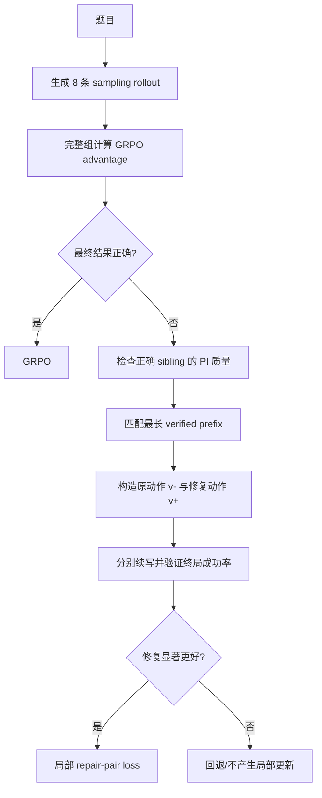

# PI-Gated Local Repair for SRPO

## 核心想法

每道题生成 8 条 on-policy rollout：

- 正确 rollout：继续使用 GRPO；
- 错误 rollout：寻找共享最长有效前缀的正确 sibling；
- 教师流程提出局部修复；
- 教师结果验证修复是否提升终局成功率；
- 只训练通过验证的 repair pair。

> **流程 PI 负责“怎样改”，结果 PI 负责“改完是否真的有效”。**

---

## 0. 生成前提：Sampling，不是 Greedy

同一位置假设：

```text
token A：90%
token B：10%
```

| 解码方式 | 选择方式 |
|---|---|
| Sampling | 按 9:1 的概率随机抽取 |
| Greedy | 永远选择概率最大的 A |

GRPO 的多条 rollout 应使用 sampling。否则同一题生成 8 次可能完全相同，组内 reward 缺少差异。

不需要出现 50%:50% 才会分叉。若某一步为 90%:10%，采样 8 次同时看到两种动作的概率约为：

$$
1-0.9^8-0.1^8\approx57\%.
$$

因此必须记录实际生成配置：

```text
do_sample
temperature
top_p
top_k
seed
```

---

## 1. 需要解决的问题

SRPO 使用同题正确 sibling 作为 self-teacher 的 privileged information（PI）。

但：

```text
存在正确 sibling
≠ PI 过程可信
≠ PI 与当前失败兼容
≠ PI 对当前失败真正有用
```

主要风险：

1. 最终答案正确，但中间过程错误；
2. 正确 sibling 与失败 rollout 使用不同路线；
3. 教师变化很大，但变化方向错误；
4. 最终答案泄漏导致模型反向拼凑过程；
5. 验证局部修复，却训练整条失败轨迹。

---

## 2. 双通道 PI

将正确 sibling \(j\) 拆成：

$$
\mathrm{PI}_j=(a_j^*,\tau_j^*),
$$

| 内容 | 作用 |
|---|---|
| 结果 PI \(a_j^*\) | 验证修复后的终局结果 |
| 流程 PI \(\tau_j^*\) | 匹配路线、寻找分叉、提出局部修复 |

核心版本不把最终答案暴露给所有中间推理 token，避免 answer shortcut。

---

## 3. 完整流程



---

## 4. PI 的三道门

### 4.1 质量门

$$
Q_j=mathbf 1[
\text{结果正确}
\land\text{暴露的过程可验证}
\land\text{非 answer-only shortcut}
].
$$

如果教师看到完整过程，应尽量验证完整过程。模型自评不能代替独立 checker。

### 4.2 兼容门

$$
C_{ij}=\operatorname{VerifiedPrefixMatch}(y_i^-,\tau_j^*).
$$

匹配对象是：

- 相同的有效操作前缀；
- 相同或等价的中间状态；
- 第一个关键分叉前的过程。

不是整条文本、长度或措辞相似度。

### 4.3 效用门

从相同前缀 \(h_i\) 构造：

```text
原分支：h_i + v_i^-
修复分支：h_i + v_{ij}^+
```

冻结旧策略，分别继续生成 suffix：

$$
p_{ij}^-=\Pr(\text{success}\mid h_i\oplus v_i^-),
$$

$$
p_{ij}^+=\Pr(\text{success}\mid h_i\oplus v_{ij}^+).
$$

定义：

$$
U_{ij}=p_{ij}^+-p_{ij}^-.
$$

只有 \(U_{ij}>\delta\) 并通过预注册统计判定，repair pair 才能进入训练。

---

## 5. PI 可用性定义

原定义：

$$
m_i=\mathbf 1[\text{存在正确 sibling}].
$$

新定义：

$$
m_i^{\mathrm{PI}}
=\mathbf 1[
\exists j:
Q_j=1,
C_{ij}\ge\tau_c,
U_{ij}>\delta
].
$$

即：

```text
存在正确 sibling
→ PI 可信
→ 与失败路线兼容
→ 能给出合法局部修复
→ 修复提高终局成功率
→ 才允许学习
```

---

## 6. 简单例子

题目：

$$
3(x+2)=15
$$

```text
正确 sibling：
两边除以3 → x+2=5
两边减2   → x=3

错误 rollout：
两边除以3 → x+2=5
两边加2   → x=7
```

构造：

```text
h  = x+2=5
v- = add_both_sides(2)      → x=7
v+ = subtract_both_sides(2) → x=3
```

这里两条轨迹不是“完整方法完全相同”，而是：

- 共享相同高层路线和有效前缀；
- 在关键动作处分叉；
- 正确 sibling 提供有效替代动作。

若修复分支的终局成功率显著提高，才学习 \(v^+\) 相对于 \(v^-\) 的偏好。

---

## 7. 训练目标

正确 rollout 保持 GRPO。

对于 accepted repair pair，定义：

$$
\ell_\theta(v\mid h)
=\sum_{t=1}^{|v|}\log\pi_\theta(v_t\mid h,v_{<t}),
$$

$$
d_\theta(h,v)
=\ell_\theta(v\mid h)-\ell_{\mathrm{old}}(v\mid h).
$$

局部 pair loss：

$$
\mathcal L_{\mathrm{pair}}
=-\log\sigma\left(
\beta[d_\theta(h,v^+)-d_\theta(h,v^-)]
\right).
$$

总损失：

$$
\mathcal L
=\mathcal L_{\mathrm{GRPO}}
+\lambda_{\mathrm{pair}}\mathcal L_{\mathrm{pair}}.
$$

验证对象与训练对象都是同一个局部 repair span，避免“验证局部、训练整条”的逻辑跳跃。

---

## 8. 最小实验闭环

### Gate A：数据可行性

统计：

- exact duplicate rate；
- 方法簇数量；
- 同一 verified prefix 下是否同时存在正确与错误分支；
- PI 质量门通过率；
- 兼容 PI 覆盖率；
- 可构造 repair pair 的比例。

若 mixed-prefix pair 很少，方法缺少作用空间，应停止而不是增加复杂模块。

### Gate B：冻结 checkpoint pilot

测量：

- \(p^+-p^-\)；
- accepted pair 数量和覆盖率；
- span 长度与位置；
- answer-only proposal 比例；
- 每个 pair 的额外 suffix token；
- 不同方法簇的接受率。

### Gate C：训练对照

比较：

1. 原 SRPO；
2. 只做 sibling 匹配、仍用 full SDPO；
3. 匹配 PI + outcome-verified local repair。

统一报告：

- 无 PI held-out pass@1；
- valid-step rate；
- 方法覆盖与多样性；
- 分布转移结果；
- 总生成 token / GPU 时间；
- 至少 3 个训练 seed。

---

## 9. 成本与风险

设平均有 \(F\) 条失败 rollout，两条分支各采样 \(N\) 个 suffix，额外生成量约为：

$$
2FN.
$$

例如 \(F=4,N=4\)，额外需要 32 条 suffix，是原始 8-rollout 数量的 4 倍。

首版建议：

- 每条失败只尝试 top-1 PI；
- 最多回退到 top-2；
- 先做冻结 pilot；
- 缓存 checker 和 prefix 结果；
- 候选在查看 suffix outcome 前固定。

主要风险：

| 风险 | 处理方式 |
|---|---|
| 答案泄漏 | 结果 PI 只做终局验证 |
| 正确答案但错误过程 | 独立 checker 验证暴露过程 |
| 不同合法方法被误惩罚 | 只有 checker 判错的动作才能作为 \(v^-\) |
| 高频方法偏置 | 按方法簇报告覆盖率 |
| 候选挑选过拟合 | 选择与确认使用独立样本 |
| 全错组无 PI | 明确回退，不声称创造新知识 |
| 提高 temperature 制造错误 | 做等计算、等采样配置对照 |

---

## 10. 暂不使用通用 step × token 连续权重

首版采用可审计的离散权重：

```text
未验证 span：权重 0
accepted repair span：进入 pair objective
```

暂不叠加 KL、熵或 token 差异权重，因为：

- 高 KL 可能只是措辞差异；
- 低熵可能是自信错误；
- BPE token 不等于知识单元；
- repair outcome 只验证具体动作。

局部 repair 机制成立后，再研究 accepted span 内的 token calibration。

---

## 11. 方法边界

建议表述为：

> **Strategy-compatible privileged information routing with outcome-verified local repair.**

- [SRPO](https://arxiv.org/html/2604.02288v1)：正确样本走 GRPO，有教师信息的错误样本走 SDPO；
- [OPSD](https://arxiv.org/html/2601.18734v3)：同模型在普通与特权上下文下分别充当学生和教师；
- [TOPD](https://arxiv.org/html/2606.00305)：局部 token 分歧不一定对应真实推理分叉。

本方法不声称解决：

- 所有全错组；
- 模型中完全不存在的知识；
- 一般开放式错误定位；
- “真正知识”的内部机制证明。

---

## 12. 最终闭环

```text
Sampling 生成多个 rollout
→ 正确 sibling 提供结果 PI 与流程 PI
→ 检查 PI 质量
→ 匹配共享 verified prefix
→ 构造局部 v-/v+ repair pair
→ 用结果 PI 验证终局收益
→ 只训练通过验证的 repair span
→ 测试时移除 PI
→ 检查学生能否独立完成任务
```

> **关键不再是“存在正确 sibling”，而是“存在一份可信、兼容，并且能通过反事实验证证明有效的 PI”。**
