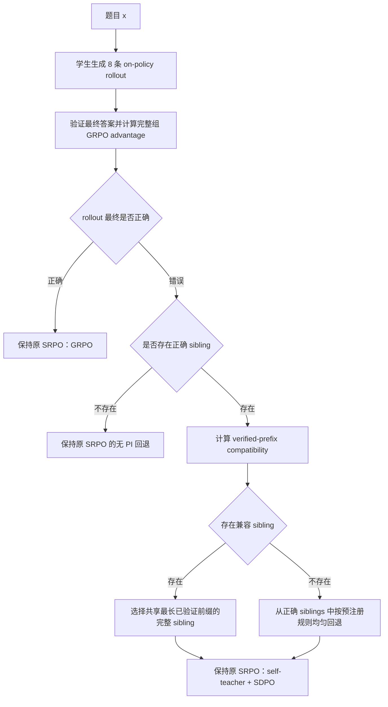

# Strategy-Matched SRPO

## 一句话概括

在 SRPO 中，正确 rollout 继续走 GRPO；对于错误 rollout，不再随意选择一条正确 sibling 作为教师特权信息，而是优先选择一条与错误 rollout **共享相同已验证推理前缀**的正确 sibling，再使用原 SRPO 的自蒸馏目标进行训练。

核心目的不是创造更强教师，而是让同一个模型看到一条与当前失败路线兼容的成功证据。

---

## 1. 要解决的问题

SRPO 的基本路线是：

- 最终答案正确的 rollout → GRPO；
- 最终答案错误且存在正确 sibling 的 rollout → SDPO；
- 正确 sibling 的完整回答作为 self-teacher 的 privileged information（PI）。

但这里存在一个未解决的问题：**同一道题可能有多种正确方法，而任意正确 sibling 不一定适合当前错误 rollout。**

例如，错误 rollout 采用“先除法”，教师 PI 却采用“先展开”。两条路线都可能合法，但它们的中间状态和下一步动作不同。自教师可能把正常的方法差异误当成错误，也可能无法准确纠正当前失败步骤。

因此，本方案要回答的问题是：

> 对一条具体的失败 rollout，哪一条正确 sibling 最适合作为它的教师信息？

---

## 2. 最简单的例子

题目：

$$
3(x+2)=15
$$

学生生成三条代表性 rollout：

```text
正确 A：展开法
3x+6=15 → 3x=9 → x=3

正确 B：先除法
x+2=5 → x=5-2=3

错误 C：先除法
x+2=5 → x=5+2=7
```

对于错误 C：

- A 的最终答案正确，但路线不同；
- B 与 C 都先得到 `x+2=5`；
- B 和 C 的分叉只发生在下一步：`5-2` 与 `5+2`。

因此，B 比 A 更适合作为 C 的 PI。

这里的关键不是“文本更像”，而是：

```text
错误 C 与正确 B 共享同一个经过验证的中间状态和操作前缀。
```

---

## 3. 核心流程



必须先用完整 8 条 rollout 计算组相对 advantage，再进行样本路由，避免改变 GRPO 的组基线。

---

## 4. 如何定义“相同方法”

### 4.1 不能直接使用整条文本相似度

整条文本相似可能受到以下因素干扰：

- 措辞和格式；
- rollout 长度；
- 最终答案；
- 错误发生后的连锁偏离。

因此，“embedding 最近”不能直接等价于“方法相同”。

### 4.2 使用已验证 transition 前缀

首个可实施版本限定在具有结构化状态和确定性 checker 的任务中，例如单变量线性方程。

每个步骤表示为：

```text
<op>divide_both_sides(3)</op>
<state>x+2=5</state>
```

定义一个 transition key：

$$
z_k=
(\operatorname{canon}(s_{k-1}),\ o_k(\text{args}),\ \operatorname{canon}(s_k)).
$$

其中：

- \(s_{k-1}\)：操作前的规范化状态；
- \(o_k(\text{args})\)：带参数的操作；
- \(s_k\)：操作后的规范化状态。

checker 从题目给出的初始状态开始，逐步验证每个 transition。对于失败 rollout，只保留第一条 invalid 或 unsupported transition 之前的 verified prefix。

对于失败 rollout \(i\) 和正确 sibling \(j\)，定义：

$$
L_{ij}=\text{两条 rollout 从开头连续相同的 verified transition 数量}.
$$

候选集合为：

$$
E_i=\{j:r_j=1,\ L_{ij}\ge 1\}.
$$

选择规则：

1. 如果 \(E_i\neq\varnothing\)，选择 \(L_{ij}\) 最大的正确 sibling；
2. 多条 sibling 并列时，均匀采样一条完整轨迹；
3. 如果 \(E_i=\varnothing\)，从全部正确 siblings 中均匀回退；
4. 不允许逐 token 混合不同 siblings，避免产生不存在的混合方法。

恒等 no-op、题目复述和格式 token 不计入 verified transition。

---

## 5. 训练目标保持不变

本方案的首版只修改 **teacher-information selector**，不同时修改 SRPO 的损失。

### 正确 rollout

继续使用 GRPO：

$$
A_i=\frac{r_i-\bar r}{\sigma_r+\epsilon}.
$$

正确方法之间不互相蒸馏，避免强行规定一种正确路线优于另一种。

### 错误 rollout

令 \(y_{j^*}^{+}\) 为匹配得到的正确 sibling，self-teacher 为：

$$
q_{i,t}(v)
=\pi_{\mathrm{stop}}
(v\mid x,y_{j^*}^{+},y_{i,<t}^{-}).
$$

然后继续使用原 SRPO 的 entropy-weighted SDPO。

这样可以单独检验：**只改教师信息的选择，是否真的带来更好的监督和学生性能。**

---

## 6. 为什么同一个模型仍可能受益

学生和教师使用同一个基础模型，并不意味着这个方案没有意义。

如果模型已经生成过一条与失败路线相同的正确 sibling，至少说明：

```text
这种方法存在于当前模型的策略支持集中，只是生成不稳定。
```

匹配 PI 的作用是检索并激活这次成功行为，让 self-teacher 在失败前缀上提供更兼容的条件分布。

但这不等于创造新知识：

- 如果 8 条 rollout 全错，没有成功证据；
- 如果某种方法从未成功生成，模型没有可用的同方法教师；
- 如果 PI 改善但训练后无 PI 性能不变，也不能说学生学会了该知识。

---

## 7. 必须防止的错误前提

### 7.1 最终答案正确不等于过程正确

正确 sibling 可能因为错误抵消而偶然得到正确答案。

在结构化数学 pilot 中，教师候选应尽量满足：

```text
最终答案正确 + 被使用的推理 transition 可以验证。
```

如果能够低成本验证整条教师过程，应进一步报告 full-process-valid teacher 的覆盖率。

### 7.2 共享前缀不等于整条方法完全相同

两条轨迹可能前两步相同，之后采用不同路线。因此，本方案只声称“前缀兼容”，不声称完整策略身份相同。

### 7.3 教师更匹配不等于更新一定有效

self-teacher 已经看到了学生失败前缀，额外提供匹配 sibling 也可能是冗余信息。因此必须进行同前缀配对实验，而不能只凭直觉论证。

### 7.4 高频方法偏置

常见且容易成功的方法更容易找到匹配 sibling；稀有方法可能频繁回退。必须按方法簇报告匹配率和性能，不能只报告总体准确率。

---

## 8. 三阶段验证闭环

### Gate A：Selection Opportunity Audit

先在冻结 checkpoint 上生成固定的 8-rollout 组，统计：

- 有至少两条正确 sibling 的失败样本比例；
- 同时存在兼容与不兼容正确 sibling 的比例；
- compatible siblings 的共享前缀长度是否存在差异；
- checker 支持率；
- 匹配成功率与均匀回退率；
- 不同方法簇的匹配覆盖。

如果真正能够改变 sibling 选择的样本太少，应停止该方向，而不是立刻增加模块。

### Gate B：同一失败前缀的教师配对诊断

固定同一个失败前缀，只切换 PI：

- matched sibling；
- incompatible 或 lower-overlap sibling；
- uniform sibling；
- text-nearest sibling。

在不查看 PI 的条件下，预先构造一个有限候选集合：

- 原始错误 step；
- 最多 15 个由任务规则生成并经 checker 验证的合法 next steps。

比较不同 PI 下，教师分配给合法候选的归一化概率质量：

$$
P_q^{\mathrm{valid}}
=\frac{\sum_{v\in V_{\mathrm{valid}}}\exp(\ell_q(v\mid h))}
{\sum_{v\in V(h)}\exp(\ell_q(v\mid h))}.
$$

如果 matched PI 不能提高合法候选偏好，停止进入长训练。

### Gate C：两组训练实验

只比较：

1. Uniform-sibling SRPO；
2. Verified-prefix-selector SRPO。

两组保持：

- 相同起始 checkpoint；
- 相同 prompt 日程；
- 每题固定 8 条 rollout；
- 相同解码参数、最大长度、优化步数和硬件；
- 至少 3 个训练 seed。

报告：

- 无 PI held-out pass@1；
- 有效 transition 比例；
- 方法簇覆盖；
- 实际生成 token；
- teacher-context token；
- teacher forward 次数；
- wall-clock 与等计算学习曲线。

---

## 9. 结果如何解释

| 观察结果 | 可以得出的结论 |
|---|---|
| Gate A 机会很少 | 固定 8 rollout 下，该 selector 缺乏作用空间 |
| Gate B 无改善 | 同方法 PI 没有改善条件教师信号 |
| Gate B 改善、Gate C 不改善 | 教师信号改善没有转化为学生能力 |
| Gate B、Gate C 都改善 | sibling 选择值得扩展到更开放任务 |

即使 Gate C 改善，也不能直接声称模型获得了“真正知识”；最多说明无 PI 行为和可验证推理质量得到改善。

---

## 10. 为什么暂时不做 step × token 连续权重

教师选择是上游问题。如果 PI 与失败路线不兼容，再精细的 step/token 权重也可能只是更强地放大错误监督。

因此推荐顺序是：

```text
先验证教师选对了
→ 再验证教师信号能否转化为学生能力
→ 最后才研究 step/token 的细粒度信用分配
```

首版不同时引入新权重、新 critic、repair generator 或 trajectory loss，以保证因果结论清晰。

---

## 11. 研究定位与相关工作边界

建议将方法定位为：

> **Failure-conditioned, correctness-verified, transition-prefix-compatible sibling assignment.**

边界如下：

- [SRPO](https://arxiv.org/html/2604.02288v1) 使用正确 sibling 作为 PI，但论文只规定选择一条，没有公开方法匹配 selector；
- [OPSD](https://arxiv.org/html/2601.18734v3) 使用同模型、不同上下文的 student/teacher 进行 on-policy self-distillation；
- [RSR](https://arxiv.org/html/2601.14249v5) 研究轨迹对学生整体的适配性，不针对某条具体失败 rollout 配对；
- [TOPD](https://arxiv.org/html/2606.00305) 研究同前缀下的短期轨迹分叉和多 token 指导，不负责选择正确 sibling；
- [InFlow](https://arxiv.org/html/2609.36695v2) 使用跨题内部表示相似性选择自蒸馏上下文，不是同题正确/错误 rollout 的前缀兼容分配。

因此，不能宽泛声称“首个 similarity-aware self-distillation”。真正需要验证的新意，是针对一条具体失败轨迹选择与其已验证前缀兼容的成功上下文。

---

## 12. 最终决策

这个方向值得作为第一优先级 pilot，原因是：

1. 它直接解决“教师没有看到学生当前方法的成功版本”这一问题；
2. 它只修改 PI selector，容易与原 SRPO 做干净对照；
3. 它复用已有 8 条 rollout，匹配本身不需要额外生成；
4. 它具有明确的停止条件，不需要在失败时不断堆叠新模块。

同时必须保持结论克制：它解决的是 **教师信息的兼容性选择**，不是全错组、未知知识、一般错误定位或完整 token 信用分配。
