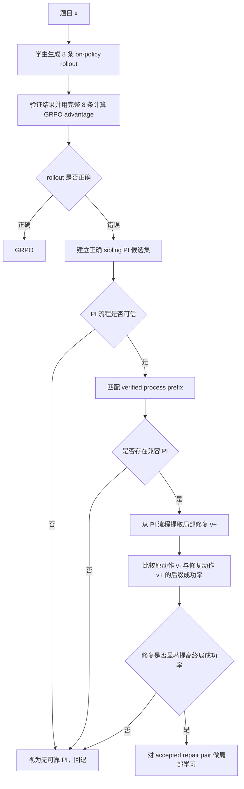

# PI-Gated Verified Local Repair for SRPO

## 一句话概括

学生对每道题生成 8 条 on-policy rollout。最终正确的 rollout 继续走 GRPO；对于错误 rollout，先从正确 siblings 中寻找与其推理路线兼容的教师流程，再利用教师流程提出局部修复，最后用教师的正确结果验证该修复是否真的提高终局成功率。只有通过验证的局部 repair pair 才进入训练。

核心原则是：

> **解题流程负责告诉学生“哪里、怎样改”；最终结果负责验证“这样改是否真的有用”。**

---

## 1. 问题背景

SRPO 的基本路由为：

- 最终答案正确的 rollout → GRPO；
- 最终答案错误且存在教师信息的 rollout → SDPO；
- 同题正确 sibling 的完整回答可作为 self-teacher 的 privileged information（PI）。

但“存在正确 sibling”只说明 PI 可以构造，不代表：

1. 这条 sibling 的解题过程可信；
2. 它与当前错误 rollout 的方法兼容；
3. 它能给当前失败轨迹提供新增信息；
4. 它造成的教师分布变化方向正确；
5. 这种变化最终能够转化成学生无 PI 的推理能力。

因此，本方法不再把 teacher availability 简单定义为“存在正确 sibling”，而是检查 PI 的质量、兼容性和反事实效用。

---

## 2. 必须先纠正的错误前提

### 2.1 最终答案正确不等于过程正确

一条 rollout 可能通过错误抵消得到正确答案。因此：

```text
final correct ≠ process correct
```

如果教师将看到完整过程，就应该尽量验证完整过程；如果只能验证局部过程，则只能把经过验证的片段作为可靠 PI，不能把后半段默认当成真值。

### 2.2 同方法不等于有用

self-teacher 已经看到了学生的失败前缀。同方法 sibling 可能只是重复学生已经知道的内容，没有产生任何新增指导。

### 2.3 高置信度不等于正确

低熵、高置信度或较大的 KL/JS 只能说明教师分布发生了明显变化，不能证明变化朝正确方向发生。同一个模型也可能非常自信地重复错误。

### 2.4 “充分利用 PI”不等于把全部信息喂给所有 token

如果中间推理阶段始终直接看到最终答案，模型可能学会根据答案反向拼凑过程，形成 answer shortcut。训练准确率可能上升，但无 PI 推理能力不一定提升。

因此，最终答案和解题流程必须分工，而不是无差别拼接。

---

## 3. 双通道特权信息

对正确 sibling \(j\)，将 PI 拆成：

$$
\mathrm{PI}_j=(a_j^*,\tau_j^*),
$$

其中：

- \(a_j^*\)：经过 verifier 确认的最终结果；
- \(\tau_j^*\)：正确 sibling 的解题流程，不包含独立的 `<final>` 字段。

两部分的职责不同：

| PI 部分 | 主要作用 | 不应承担的作用 |
|---|---|---|
| 最终结果 \(a_j^*\) | 终局正确性验证、suffix 成功判定 | 直接监督所有中间推理 token |
| 解题流程 \(\tau_j^*\) | 方法匹配、寻找分叉、提出局部修复 | 单独证明修复后的终局结果正确 |

对于存在多个等价答案的任务，\(a_j^*\) 应由等价性 verifier 判断，而不是做字符串完全匹配。

---

## 4. 完整流程



必须在样本路由前，用完整 8 条 rollout 计算组相对 advantage，避免改变 GRPO 的组基线。

---

## 5. Step 1：生成 rollout 与完整组优势

对题目 \(x\)，学生策略生成：

$$
y_i\sim\pi_\theta(\cdot\mid x),\qquad i=1,\ldots,8.
$$

verifier 给出终局奖励 \(r_i\)，并在路由前计算：

$$
A_i^{\mathrm{GRPO}}
=\frac{r_i-\bar r}{\sigma_r+\epsilon}.
$$

随后再将样本分为：

- 正确 rollout：继续走 GRPO；
- 错误 rollout：进入 PI 检查与局部修复流程。

---

## 6. Step 2：检查 PI 自身质量

对正确 sibling \(j\)，定义质量门：

$$
Q_j=
\mathbf 1[
\text{final verified}
\land
\text{exposed process verified}
\land
\text{not answer-only shortcut}
].
$$

建议首个 pilot 使用具有确定性 checker 的任务，例如结构化单变量线性方程：

```text
<op>divide_both_sides(3)</op>
<state>x+2=5</state>
```

checker 从题目给出的初始状态开始执行每个操作，并验证 claimed post-state。无法解析、过程不合法或只修改 `<final>` 的 sibling 不能作为可靠过程 PI。

如果开放式任务无法验证完整过程，应分别报告：

- full-process-valid PI 覆盖率；
- partial-process-valid PI 覆盖率；
- 未验证后缀长度。

不能把“模型自评正确”当成独立 verifier。

---

## 7. Step 3：将 PI 与具体失败轨迹配对

PI 是否适合使用是 pairwise 属性，不是 sibling 的全局属性。

对失败 rollout \(i\) 和正确 sibling \(j\)，定义：

$$
C_{ij}=\operatorname{VerifiedPrefixMatch}(y_i^-,\tau_j^*).
$$

可将每个验证过的步骤表示为 transition key：

$$
z_k=
(\operatorname{canon}(s_{k-1}),\ o_k(\text{args}),\ \operatorname{canon}(s_k)).
$$

\(C_{ij}\) 取双方从开头连续共享的 verified transition 数量。匹配时禁止使用：

- 最终答案；
- 错误发生后的失败后缀；
- 整条文本长度；
- 单纯措辞或格式相似度。

先用 \(Q_j\) 过滤，再选择 \(C_{ij}\) 最大的 top-1 sibling；top-1 无法构造有效修复时，最多尝试 top-2。不要对所有 siblings 做昂贵全配对，也不要逐 token 混合多个教师。

---

## 8. Step 4：构造局部 repair pair

设失败 rollout 与教师流程共享的最长有效前缀为 \(h_i\)。在其后比较：

- 原始错误动作：\(v_i^-\)；
- 教师流程给出的候选修复：\(v_{ij}^+\)。

候选 pair 必须满足：

1. \(h_i\) 完全来自学生原始 rollout；
2. \(v_i^-\) 是完整、连续的原始 step/span；
3. \(v_{ij}^+\) 从相同状态出发；
4. checker 判定 \(v_i^-\) 无效、\(v_{ij}^+\) 有效；
5. 如果两种动作都有效，只是采用不同路线，则不能把原动作当负例；
6. 纯 `<final>` answer patch 不进入主训练。

这里使用的是教师的过程 PI，而不是最终答案。

---

## 9. Step 5：用最终结果验证局部修复

从完全相同的学生前缀构造两条分支：

```text
原分支：h_i + v_i^-
修复分支：h_i + v_{ij}^+
```

冻结行为策略 \(\pi_{\mathrm{old}}\)，分别从两条分支继续采样 suffix。使用结果 PI \(a_j^*\) 或任务 verifier 判断终局成功：

$$
p_{ij}^-=Pr_{\pi_{\mathrm{old}}}
(\text{success}\mid h_i\oplus v_i^-),
$$

$$
p_{ij}^+=\Pr_{\pi_{\mathrm{old}}}
(\text{success}\mid h_i\oplus v_{ij}^+).
$$

定义 PI 对当前失败轨迹的反事实效用：

$$
U_{ij}=p_{ij}^+-p_{ij}^-.
$$

只有当：

$$
U_{ij}>\delta
$$

并通过预注册的统计判定时，才接受该 repair pair。

候选修复必须在查看 suffix 结果之前固定，避免生成许多候选后只挑偶然效果最好的一个。若需要从 top-2 中选择，选择样本和最终确认样本必须独立，降低 winner's curse。

---

## 10. 新的 PI 可用性定义

原始 teacher-availability flag 可写成：

$$
m_i=\mathbf 1[\text{存在正确 sibling}].
$$

本方法将其改为：

$$
m_i^{\mathrm{PI}}
=\mathbf 1\left[
\exists j:
Q_j=1,
C_{ij}\ge\tau_c,
U_{ij}>\delta
\right].
$$

逻辑漏斗为：

```text
存在正确 sibling
→ PI 自身可信
→ PI 与当前失败兼容
→ PI 给出合法局部修复
→ 修复提高终局成功率
→ 才允许学习
```

若任一条件不满足，就视为“没有可靠 PI”，不能因为存在最终正确 sibling 就强行蒸馏。

---

## 11. Step 6：训练对象与验证对象对齐

如果验证的是局部修复 \(v^+\)，却对整条失败 rollout 做完整 SDPO，那么：

```text
验证对象 = 局部动作
训练对象 = 整条失败轨迹
```

二者不一致，无法证明训练更新得到验证。

因此，正确 rollout 继续走 GRPO；错误且 repair 通过验证的 rollout 只学习 accepted local pair。

定义 span 联合 log-prob：

$$
\ell_\theta(v\mid h)
=\sum_{t=1}^{|v|}\log\pi_\theta(v_t\mid h,v_{<t}).
$$

相对冻结行为策略：

$$
d_\theta(h,v)
=\ell_\theta(v\mid h)-\ell_{\mathrm{old}}(v\mid h).
$$

局部 pair loss：

$$
\mathcal L_{\mathrm{pair}}
=-\log\sigma\left(
\beta[
d_\theta(h_i,v_{ij}^+)-d_\theta(h_i,v_i^-)
]
\right).
$$

总损失：

$$
\mathcal L
=\mathcal L_{\mathrm{GRPO}}
+\lambda_{\mathrm{pair}}\mathcal L_{\mathrm{pair}}.
$$

accepted failure 不再同时接收整条负 GRPO 和完整 SDPO，避免多个不一致目标叠加。

没有可靠 PI 或 repair 未通过验证的失败样本，按预注册规则回退原 SRPO 的 GRPO 分支，或者不产生局部 pair loss；两种实现必须分开说明，不能混称。

---

## 12. 完整例子

题目：

$$
3(x+2)=15
$$

正确 sibling B：

```text
过程 PI：
1. 两边除以3：x+2=5
2. 两边减2：x=3

结果 PI：
x=3
```

错误 rollout C：

```text
1. 两边除以3：x+2=5
2. 两边加2：x=7
```

检查过程：

1. **PI 质量**：B 的结果正确，两个过程步骤均可验证；
2. **方法兼容**：B 与 C 共享 `divide_both_sides(3)` 和状态 `x+2=5`；
3. **局部 pair**：

   ```text
   h  = x+2=5
   v- = add_both_sides(2)      → x=7
   v+ = subtract_both_sides(2) → x=3
   ```

4. **终局验证**：分别从 `h+v-` 与 `h+v+` 继续 rollout；
5. **接受条件**：修复分支得到正确答案的概率显著高于原分支；
6. **训练**：只提高 `subtract_both_sides(2)` 相对于 `add_both_sides(2)` 的概率。

模型学习的是：

```text
在状态 x+2=5 下，应当两边减2，而不是加2。
```

而不是简单记忆“最终答案是 3”。

---

## 13. 最小实验闭环

### Gate A：PI 漏斗审计

对失败样本依次报告：

- 存在正确 sibling 的比例；
- PI 过程通过质量门 \(Q\) 的比例；
- 存在兼容 PI 的比例；
- 能构造合法 repair pair 的比例；
- repair 通过反事实验证的比例；
- 最终 accepted pair 覆盖率。

这可以区分：

```text
没有成功证据
PI 本身不可信
PI 与失败不兼容
能修局部但不能改善终局
真正可学习的 repair
```

### Gate B：冻结 checkpoint pilot

在不训练的情况下测量：

- \(p^+ - p^-\) 的分布；
- accepted pair 数量；
- span 长度与位置；
- 每个 accepted pair 的额外 suffix token；
- answer-only proposal 比例；
- 不同方法簇的接受率。

如果预算内几乎没有 accepted pair，就停止，不叠加更多模块。

### Gate C：训练对照

建议至少比较：

1. **原 SRPO**：正确 sibling PI + full SDPO；
2. **Matched-PI SRPO**：只改 sibling 选择，仍使用 full SDPO；
3. **Proposed**：matched PI + verified local repair pair。

所有方法按总生成 token 或 GPU 时间匹配，报告：

- 无 PI held-out pass@1；
- 分布转移测试；
- valid-step rate；
- 方法簇覆盖与多样性；
- accepted-pair coverage；
- 训练和验证额外成本；
- 至少 3 个训练 seed。

只有 Proposed 在等计算条件下稳定优于前两个基线，才能支持完整机制有效。

---

## 14. 主要成本

设每题平均有 \(F\) 条失败 rollout，每个 pair 的两条分支各采样 \(N\) 个 suffix，则额外 suffix 数约为：

$$
2FN.
$$

例如：

```text
F=4，N=4
额外 suffix = 2×4×4 = 32
```

相比原始 8 条 rollout，额外生成量约为 4 倍，还没有计算 PI 检查和 teacher forward。因此首版建议：

- 每条失败只尝试 top-1 PI；
- top-1 无法形成合法 pair 时最多尝试 top-2；
- 先做冻结 checkpoint pilot；
- 可以只抽样部分失败 rollout，抽样率必须预注册；
- 缓存过程解析、checker 结果和共享前缀。

---

## 15. 主要风险与认知偏差

### Answer leakage

把最终答案暴露给所有中间步骤，可能得到反向拼凑过程。核心版本只用结果 PI 做终局验证。

### Survivorship bias

容易题和高频方法更容易产生正确 sibling，也更容易进入训练。必须同时报告 accepted 子集收益和所有失败样本上的总体收益。

### Winner's curse

候选越多，越容易选到偶然高成功率的 repair。候选必须提前固定，选择与最终确认尽量使用独立样本。

### 多方法误惩罚

与教师不同不代表学生错误。只有原动作被独立 checker 判错时，才能作为 \(v^-\)。

### 全错组边界

如果 8 条 rollout 全错，本方法没有可信结果 PI 和过程 PI，不能凭空生成知识。

### PI 改善不等于知识形成

即使 repair pair 有效、无 PI 准确率提高，也只能证明行为层面的迁移，不能唯一证明模型内部形成了抽象知识。

---

## 16. 为什么暂时不做通用 step × token 连续权重

本方法已经给出了可审计的局部权重：

```text
未验证 token/span：权重 0
accepted repair span：进入 pair objective
```

首版不再叠加基于 KL、熵或 token 差异的连续权重，原因是：

- 可能重复放大同一代理信号；
- 高 KL 可能只是措辞差异；
- 低熵可能是自信错误；
- BPE token 不是知识单元；
- repair 验证的是具体动作，不是任意教师分布。

如果局部 repair 机制成立，再研究 accepted step 内的细粒度 token calibration。

---

## 17. 方法边界与相关工作

建议将当前方法表述为：

> **Strategy-compatible privileged information routing with outcome-verified local repair.**

- [SRPO](https://arxiv.org/html/2604.02288v1) 将正确样本路由到 GRPO，将有教师信息的错误样本路由到 SDPO，并用教师熵做动态权重；其教师信息构造使用同题正确 sibling。
- [OPSD](https://arxiv.org/html/2601.18734v3) 使用同模型在普通上下文和特权上下文下分别充当学生与教师。
- [TOPD](https://arxiv.org/html/2606.00305) 指出局部 token 分歧不一定对应真实推理分叉，且单 token 修正不一定恢复完整轨迹。

当前方案不声称解决一般错误定位、所有全错组或模型参数中不存在的知识。它要验证的核心是：

> 当同模型已经生成过一条兼容的成功流程时，能否利用该流程提出局部修复，并用正确结果筛出真正提高终局成功率的修复，再把这一动作级信号蒸馏回无 PI 学生。

---

## 18. 最终逻辑闭环

```text
学生生成多个 rollout
→ 正确 sibling 提供结果 PI 与流程 PI
→ 检查 PI 本身是否可信
→ 将流程 PI 与具体失败路线匹配
→ 在共享前缀后提出局部修复
→ 用结果 PI 验证修复后的终局成功率
→ 只训练通过验证的 repair pair
→ 测试时移除全部 PI
→ 检查学生是否仍能独立完成任务
```

整个方法的核心不是“存在正确 sibling”，而是：

> **存在一份可信、兼容，并且能通过反事实验证证明对当前失败真正有用的特权信息。**
